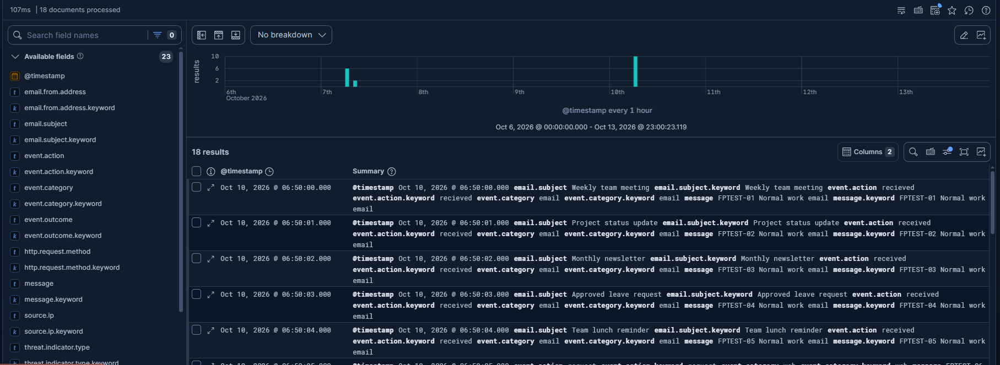
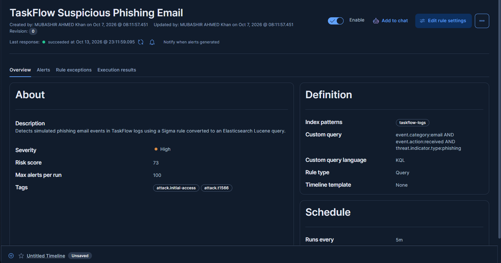
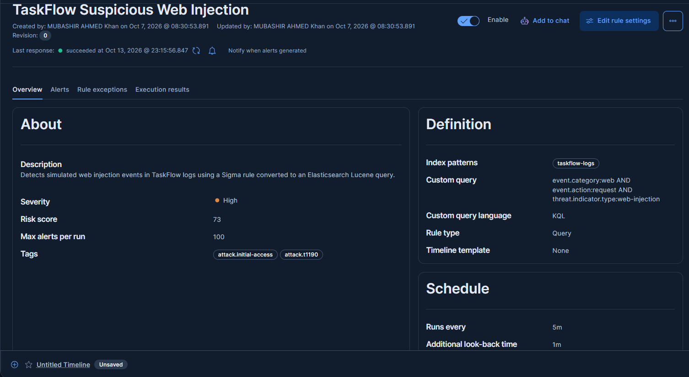
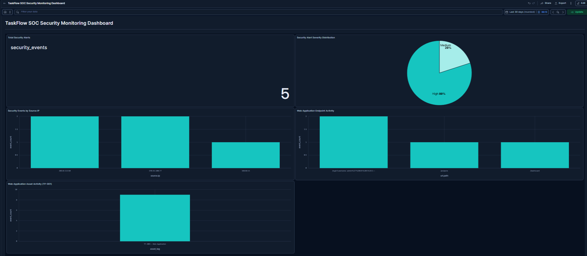

# TaskFlow Software SOC Incident Response Package

## Overview

This project focuses on building a practical SOC incident response solution for TaskFlow Software, a SaaS project-management company.

The project covers asset risk assessment, detection engineering, security monitoring, incident response playbooks, and a final hand-over package.

## Project Tasks

1. Asset Inventory and Risk Register
2. Sigma Detection Rules
3. Security Monitoring Dashboard
4. Incident Response Playbooks and Tabletop Exercise
5. Final Hand-over Package

## Task 1 - Asset Inventory and Risk Register

Task 1 identifies the important logical assets used by TaskFlow Software and evaluates their security impact using the CIA triad:

- Confidentiality
- Integrity
- Availability

Each asset is scored from 1 to 5. The overall risk score is calculated by averaging the Confidentiality, Integrity, and Availability scores.

Seven assets were assessed, including the web application, REST API, customer database, authentication service, CI/CD pipeline, source code repository, and logging and monitoring system.

## Files

- [`assets.json`](assets.json) - Contains the asset inventory, CIA scores, and overall risk ratings.
- [`assets.md`](assets.md) - Explains the risk assessment methodology and summarizes the findings.

## Key Finding

The Authentication Service received the highest risk score of **5.0 (Critical)**. The Web Application, REST API, and Customer Database were also identified as critical assets.

These results will help prioritize monitoring and detection rules in the next stages of the project.

## Status

- [x] Task 1 - Asset Inventory and Risk Register
- [x] Task 2 - Sigma Detection Rules
- [x] Task 3 - Security Monitoring Dashboard
- [x] Task 4 - Incident Response Playbooks and Tabletop Exercise
- [ ] Task 5 - Final Hand-over Package

## Author

Mubashir Ahmad  
Cyber Security Intern


### Task 2 — Sigma Detection Rules in Elastic Stack

I implemented and tested Sigma detection rules in Elastic Security to identify simulated phishing emails and web-injection attacks. I converted the detection logic into Elasticsearch-compatible queries, configured SIEM rules in Kibana, and verified that both attack scenarios generated security alerts. I also tested the rules against 10 benign log events and observed zero false-positive alerts (0%). The testing was performed using a controlled sample dataset, so the results do not represent production accuracy.


### Elastic Cloud Log Index Evidence

I configured an Elastic Cloud Security Serverless project and ingested sample security events into the `taskflow-logs` index.

I verified the indexed data using Kibana Discover with the following ES|QL query:

```esql
FROM taskflow-logs
| LIMIT 100
```

The query successfully processed 18 documents, including simulated security events and benign test logs.

**Evidence — Elastic log index in Kibana Discover:**




### Kibana Detection Rules — Deployment Evidence

I configured two custom detection rules in Elastic Security using the `taskflow-logs` index. Both rules are enabled and have successfully executed.

#### 1. Phishing Email Detection

- Rule: `TaskFlow Suspicious Phishing Email`
- Index: `taskflow-logs`
- Query language: KQL
- Severity: High
- MITRE ATT&CK: T1566
- Status: Enabled

KQL query configured in Kibana:

```kql
event.category:email AND event.action:received AND threat.indicator.type:phishing
```



#### 2. Web Injection Detection

- Rule: `TaskFlow Suspicious Web Injection`
- Index: `taskflow-logs`
- Query language: KQL
- Severity: High
- MITRE ATT&CK: T1190
- Status: Enabled

KQL query configured in Kibana:

```kql
event.category:web AND event.action:request AND threat.indicator.type:web-injection
```



### Detection Validation

Both rules previously generated alerts during controlled attack simulations. I also tested 10 benign events and observed zero new false-positive alerts (0/10 = 0%).

These results demonstrate the configured detection workflow on a limited simulated dataset, not production detection accuracy.


### Sigma-to-Elasticsearch Query Conversion

The original Sigma rules and their converted Lucene queries are stored in the `rules/` directory.

| Detection | Original Sigma rule | Converted Lucene query |
|---|---|---|
| Phishing | [phishing_detection.yml](rules/phishing_detection.yml) | [phishing_detection.lucene](rules/phishing_detection.lucene) |
| Web injection | [web_injection_detection.yml](rules/web_injection_detection.yml) | [web_injection_detection.lucene](rules/web_injection_detection.lucene) |

**Converted phishing query (Lucene):**

```text
event.category:email AND event.action:received AND threat.indicator.type:phishing
```

**Converted web-injection query (Lucene):**

```text
event.category:web AND event.action:request AND threat.indicator.type:web\-injection
```

The corresponding detection rules are configured and enabled in Kibana using KQL. Screenshots above show their enabled status, index patterns, and deployed queries.


## Task 3 - SOC Security Monitoring Dashboard

Created a security monitoring dashboard using Elastic Stack,
Elasticsearch, ES|QL, and Kibana.

### Dashboard Features
- Security event monitoring
- Severity distribution pie chart
- Source IP activity analysis
- Affected application endpoints visualization
- Web Application Asset Activity (TF-001)
- Automatic refresh every 30 seconds

### Testing Results
- 18 sample log events analyzed
- 5 potential security events identified
- Severity distribution: 80% High, 20% Medium
- Source IP activity visualized
- 9 web events associated with TF-001
- Successfully tested dashboard updates using a simulated event
- Removed the simulated event after testing

### Dashboard Evidence


### Investigation Report
See [Task 3 Incident Investigation](reports/task3_incident_investigation.md).

### Tools Used
- Elastic Cloud
- Kibana
- Elasticsearch
- ES|QL
- GitHub
- VS Code

## Task 4 - Incident Response Playbooks and Tabletop Exercise

Developed three incident response playbooks and documented a simulated API injection incident to evaluate TaskFlow Software's SOC response procedures.

### Incident Response Playbooks

Created three playbooks covering detection, investigation, containment, eradication, recovery, responsibilities, and incident closure.

| Playbook | Affected Assets | PDF |
|---|---|---|
| Phishing Incident Response | TF-004, TF-003, TF-001, TF-007 | [Phishing Playbook](playbooks/phishing_playbook.pdf) |
| Ransomware Incident Response | TF-003, TF-001, TF-002, TF-005, TF-006, TF-007 | [Ransomware Playbook](playbooks/ransomware_playbook.pdf) |
| API Injection Incident Response | TF-002, TF-003, TF-001, TF-004, TF-007 | [API Injection Playbook](playbooks/api_injection_playbook.pdf) |

Each playbook was exported as a two-page PDF and references the Task 1 asset inventory.

### Tabletop Exercise

Conducted a simulated API injection incident response walkthrough using mock security alerts.

**Incident ID:** INC-TF-001

**Scenario:** Suspicious API requests targeting TaskFlow's REST API (TF-002), with potential risk to the Customer Database (TF-003).

**Exercise Findings:**
- Analyzed four simulated security alerts.
- Identified repeated suspicious requests from a single test IP.
- Reviewed the incident timeline and response decisions.
- Walked through proposed containment, eradication, and recovery procedures.
- Identified four security gaps and documented improvement recommendations.
- No actual database compromise was confirmed.
- No live containment or recovery actions were performed.

### Tabletop Evidence

- [Tabletop Exercise Report](tabletop/tabletop_exercise_report.md)
- [Mock Security Alerts](tabletop/mock_alerts.json)
- [API Injection Response Playbook](playbooks/api_injection_playbook.md)

### Improvement Log

| ID | Improvement Recommendation | Priority |
|---|---|---|
| IMP-001 | Improve API request logging and Elastic Security correlation | High |
| IMP-002 | Enable database audit logging | High |
| IMP-003 | Test WAF blocking and API rate-limiting procedures | High |
| IMP-004 | Conduct authorized API recovery and security regression testing | Medium |

### Tools Used

- Visual Studio Code
- Markdown
- Markdown PDF
- JSON
- GitHub
- Elastic Security and Kibana (previous detection and monitoring work)

### Task 4 Outcome

Completed three incident response playbooks and documented a tabletop exercise demonstrating the proposed response to an API injection incident.

The exercise identified improvements needed in API logging, database auditing, containment procedures, and recovery testing. These findings will support the final project handover in Task 5.

## Task 5 - Final Handover and Elastic Cloud Demo

### Live Elastic Cloud Demo

- [Elastic Security Project](https://my-security-project-a4fd4d.kb.us-central1.gcp.elastic.cloud/app/security/get_started)
- [TaskFlow SOC Dashboard](https://my-security-project-a4fd4d.kb.us-central1.gcp.elastic.cloud/app/r/s/DELQe)

### How to View the Demo

1. Open the TaskFlow SOC Dashboard link.
2. Sign in using an authorized Elastic Cloud account with access to the project.
3. Set the Kibana time range to **Last 30 days**, or a custom range covering the October 2026 test events.
4. Review the security monitoring charts, source IP activity, and affected application endpoints.
5. Open Elastic Security to review the configured detection rules and available alerts.

**Access note:** The dashboard is hosted in Elastic Cloud and may require authentication and project permissions. Public reviewer access has not yet been verified.

**Data note:** This demonstration uses simulated security events and does not represent live production monitoring.