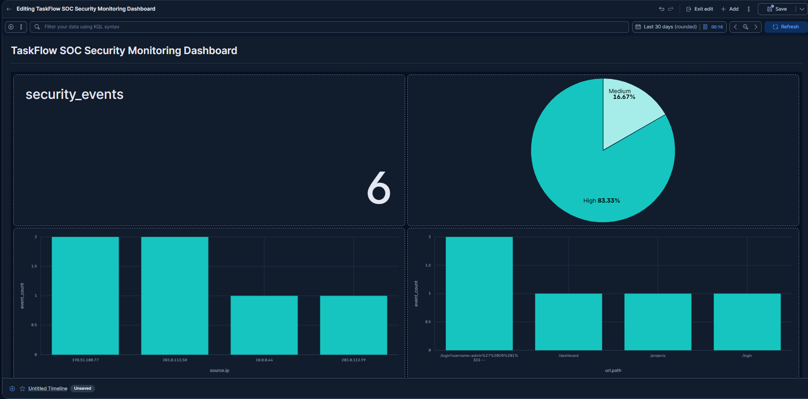

# TaskFlow Software — SOC Incident Investigation Report

## 1. Investigation Overview

**Project:** TaskFlow SOC Incident Response Package  
**Platform:** Elastic Stack (Kibana Discover)  
**Investigation Date:** October 15, 2026  
**Analyst Role:** SOC Analyst  
**Environment:** Simulated security monitoring lab

### Objective

Investigate suspicious security events, identify potentially affected assets, review authentication activity, and document findings and recommended response actions.

## 2. Investigation Summary

A total of 18 security log events were reviewed using Kibana Discover.

The dataset contained:
- 9 web events
- 7 email events
- 2 authentication events

The investigation identified:
- 2 potential SQL injection attempts
- 2 phishing-related email events
- 1 failed login
- 1 successful login

These events were generated in a simulated environment.

## 3. SQL Injection Investigation

**Date:** October 7, 2026  
**Suspicious Source IP:** 198.51.100.77  
**Target Endpoint:** /login  
**Potentially Affected Asset:** TF-001 — Web Application

Two web events contained suspicious SQL injection patterns targeting the login endpoint.

One event was explicitly generated to test the TaskFlow Sigma detection rule.

### Findings

- Suspicious SQL injection patterns appeared in the URL.
- Both events originated from the same source IP.
- No successful compromise was confirmed.

### Recommended Actions

- Review web application and authentication logs.
- Validate server-side input handling.
- Use parameterized SQL queries.
- Investigate suspicious requests and consider appropriate blocking controls.

## 4. Authentication Investigation

Two authentication events were identified.

| User | Source IP | Result |
|---|---|---|
| alice | 10.0.0.21 | Success |
| bob | 10.0.0.44 | Failure |

Both authentication events occurred before the suspicious SQL injection requests.

Neither event originated from the suspicious SQL injection source IP.

### Conclusion

The available authentication logs do not establish that the SQL injection attempts resulted in unauthorized access.

## 5. Phishing Investigation

**Suspicious Email Subject:** URGENT: Verify your TaskFlow account  
**Threat Indicator:** phishing

Two phishing-related email events were identified.

The remaining five email events contained no phishing indicator.

### Findings

- One event represented a suspicious phishing email.
- Another event was generated for Sigma detection testing.
- No evidence of successful credential theft was identified.

### Recommended Actions

- Investigate suspicious email links and attachments.
- Verify sender authenticity.
- Review email security controls.
- Provide phishing awareness training.

## 6. Incident Timeline

| Date and Time | Event |
|---|---|
| Oct 7, 06:00 | Successful login — alice |
| Oct 7, 06:02 | Failed login — bob |
| Oct 7, 06:03 | Suspicious phishing email received |
| Oct 7, 06:04 | Possible SQL injection attempt |
| Oct 7, 08:15 | Simulated phishing detection test |
| Oct 7, 08:30 | Simulated SQL injection detection test |

Times are displayed as recorded in Kibana.

## 7. Evidence Collected

Evidence screenshots are stored in the screenshots directory:

- task3_sql_injection_evidence.png
- task3_authentication_evidence.png
- task3_phishing_evidence.png

## 8. Investigation Conclusion

The investigation identified simulated SQL injection attempts, phishing-related emails, and authentication activity.

No successful compromise was established from the available logs.

Further investigation would require additional application, endpoint, and authentication evidence.

**Investigation Status:** Initial analysis completed  
**Confirmed Compromise:** Not established

## Dashboard Alert Testing

### Objective
Verify that the TaskFlow SOC Security Monitoring Dashboard
updates when a new simulated security event is ingested.

### Testing Procedure
1. Created a simulated high-severity SQL injection
   test event using Elasticsearch Dev Tools.
2. Inserted the event into the taskflow-logs index.
3. Refreshed the SOC monitoring dashboard.
4. Compared the security metrics before and after ingestion.
5. Deleted the simulated event after testing.

### Results
- Security events increased from 5 to 6.
- High-severity events increased from 4 to 5.
- High-severity percentage increased from 80% to 83.33%.
- Dashboard successfully reflected the new event.

### Evidence

### Challenges and Lessons Learned
The existing logs did not contain host.name or asset.name
fields, so application endpoints and source IP addresses
were used to investigate potentially affected components.

This test demonstrated how Elasticsearch ingestion,
ES|QL queries, and Kibana visualizations work together
to support SOC monitoring and incident investigation.

### Conclusion
The dashboard refresh test passed. The simulated event
was removed after testing to preserve the original dataset.
